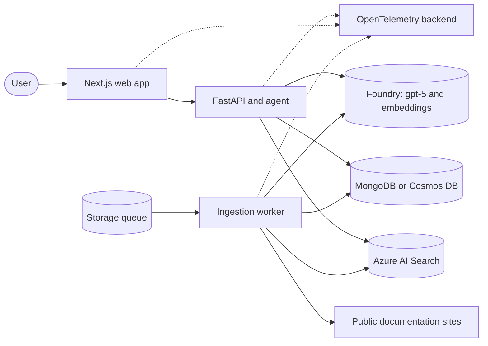

Product Support Agent is a demonstration of an AI assistant that answers
questions about OpenText products and their documentation. Every answer comes
from indexed public documentation, and every link in an answer is one the server
retrieved, never one the model wrote. The repository holds the application, the
Azure infrastructure and pipelines to run it, and the architecture, security,
and operations documents that explain it.

[](docs/demo/product-support-agent-demo.webm)

Watch the [2 min 44 s walkthrough](docs/demo/product-support-agent-demo.webm)
(select the link to play it). It shows the coverage of the 100-product sample,
the product filter, a cited answer, a follow-up, a product that is not indexed,
a refused hostile prompt, and the OpenTelemetry trace of a chat request.

## Where to start

| You want to | Read |
|---|---|
| Understand the system | [Solution architecture](docs/architecture/architecture-overview.md) |
| Run it on your machine | [Local development guide](docs/operations/local-development.md) |
| Create and test it in Azure | [Cloud setup guide](infra/README.md) |
| See how each original requirement was met | [Requirements traceability](docs/architecture/requirements-traceability.md) |
| Understand why it is built this way | [Decision register](docs/architecture/decision-register.md) and [ADRs](docs/architecture/decisions/) |
| Review security and privacy | [Security posture](docs/security/security-posture.md), [threat register](docs/security/threat-register.md), [privacy impact assessment](docs/security/privacy-impact-assessment.md) |
| Know the risks and what production needs | [Risks and assumptions](docs/architecture/risk-assumptions.md), [production gap register](docs/operations/production-gap-register.md) |
| Operate and support it | [Support ownership and runbooks](docs/architecture/support-ownership.md) |
| Change a setting | [Configuration reference](docs/operations/configuration-reference.md) |
| See the planned expansion to service management | [Service management expansion](docs/architecture/service-management-expansion.md) |
| See how it was built | [How this was built](#how-this-was-built) |

## What it provides

* **A chat interface** (Next.js) that shows which of 100 sampled products have
  documentation indexed, lets you filter by product, and answers with numbered
  source links. Conversation is kept only in the browser tab.
* **An API and agent** (FastAPI and Microsoft Agent Framework) with two
  read-only tools, `search_documentation` and `list_products`. It retrieves
  evidence with hybrid keyword and vector search, binds citations on the server,
  and refuses when nothing indexed supports an answer.
* **Queue-driven ingestion.** One queue message per product, one worker taking
  one message at a time, an outcome recorded for every product, polite and
  resumable fetching from an explicit list of documentation sources, and
  protected content skipped and recorded.
* **Telemetry** with OpenTelemetry: a trace from the browser request through the
  agent and each model call, with no question or answer text. Aspire locally,
  Azure Monitor in Azure.
* **Azure infrastructure as Bicep**: a virtual network, private data services,
  Container Apps, Key Vault, a private registry, optional classic API
  Management, and optional Foundry deployments, deployed by GitHub Actions in two
  stages.
* **An offline evaluation** of grounding, citation validity, and refusals.

## Key facts and limits

| Question | Answer |
|---|---|
| What does it cover? | **10 of the 100** sampled products (300 pages). For the other 90 it says it has no approved source; it does not guess. |
| Why only 10? | See [Source deviation](#source-deviation-from-the-original-brief). |
| What does "grounded" mean? | Every link comes from this request's retrieved evidence. It does not prove that every sentence is supported; see [Evaluation](#evaluation-results). |
| Does it store questions or answers? | No. Retention was requested in the brief but is **not built** and is blocked on privacy decisions. |
| Who can use it? | Anyone with network access: there is no end-user sign-in. Keep local runs on `127.0.0.1` and Azure environments to the team. |
| Is it production ready? | No. See the [production gap register](docs/operations/production-gap-register.md). |
| Has it run in Azure? | The Bicep has been deployed to an isolated Azure environment and used end to end. The GitHub Actions pipelines are tested offline and have not run on GitHub. See the [cloud setup guide](infra/README.md). |

## Quick start (local)

You need Podman with `podman compose`, plus a Microsoft Foundry resource with a
chat and an embedding deployment, and an Azure AI Search service. The full
steps are in the [local development guide](docs/operations/local-development.md).

```powershell
if (-not (Test-Path .env)) { Copy-Item .env.example .env }
# Edit .env: Foundry endpoint, key and deployments; Search endpoint and key
podman compose up --build -d
podman compose run --rm api python scripts/run_queue_ingestion.py run
```

Then open <http://127.0.0.1:3000>. The first ingestion run takes a few minutes
and ends with 10 products `success` and 90 `skipped`.

## Quick start (Azure)

1. Prepare an environment parameter file and, for pipeline deployment, a
   federated identity, a GitHub environment, and a runner in the virtual network.
2. Deploy the platform stage, publish the images, then deploy the workloads
   stage.
3. Run ingestion and test through the web app.

The steps, prerequisites, region checks, tests, and cleanup are in the
[cloud setup guide](infra/README.md).

## Source deviation from the original brief

The brief asks the agent to use the product list page and the search API, with
the feed as the fallback, and to skip anything that needs authentication. What
the live endpoints returned:

| Source | Result | What the code does |
|---|---|---|
| `my.opentext.com/support/products/` (listing) | HTTP 200, but client-rendered with no usable product data | Treated as empty; the next source is tried |
| `.../api/web/support/search-results` | HTTP **401** for anonymous callers | Treated as protected: skipped, never retried with credentials, and recorded |
| `.../api/web/feed/product` | HTTP 200 with 1,302 parseable products | Used as the catalog; `scripts/create_manifest.py` selects the 100 products |
| `my.opentext.com/support/products/{slug}` | Client-rendered, so it yields no documentation text | Used only as the product's support-page link |
| Documentation sites (`docs.microfocus.com`, `admhelp.microfocus.com`) | Anonymous delivery paths found for 10 of the 100 products | Ingested through the versioned [source map](docs/operations/phase-3-source-map-v1.json) |

So only 10 of 100 products have indexed documentation. For the rest, "no
approved public source" means this project did not find an anonymous source, not
that none exists. Source terms and reuse rights have not been reviewed; that is a
production gate ([ADR-0002](docs/architecture/decisions/adr-0002-source-access-and-manifest.md)).

## Evaluation results

The offline evaluation (`scripts/run_evaluation.py`) asks 15 answerable
questions and 6 that should be refused (3 off-topic, 3 adversarial). The latest
report is [phase-6-evaluation-v2.md](docs/operations/phase-6-evaluation-v2.md).

| Measure | Latest run | Meaning | Limit |
|---|---:|---|---|
| Expected source in the top five | 12/15 (80.0%) | The page a person would expect is among the first five results | Small synthetic set; three questions miss in every run |
| Citation validity | 17/17 (100%) | Every citation is a URL retrieved for that question | Checks links, not claims |
| Claim support | 10/12 (83.3%) | A judge model checks the answer against the full text of the cited pages | Model-judged; needs human review |
| Refusals | 6/6 | Off-topic and adversarial questions get the standard refusal | Six questions |

**Results vary between runs.** Three runs of the same set gave claim support of
71.4%, 76.9%, and 83.3%. The 80% target is therefore **not reliably met**. Do
not quote one run as a quality guarantee; the next steps are a larger set,
repeated runs with a reported range, and human review.

## Architecture in one picture



The [solution architecture](docs/architecture/architecture-overview.md) has
the detailed data flow, model interaction, identity, trust boundaries,
deployment diagrams, monitoring, trade-offs, and the path from proof of concept
to production.

## How this was built

The project was built phase by phase with AI coding assistants under the
author's direction: the brief was turned into a plan that was reviewed phase by
phase, each decision was recorded as an ADR, each phase ended when its tests
passed, live probes of the OpenText endpoints changed the design, and a later
review against the brief led to queue-driven ingestion, OpenTelemetry, API
Management, and the Azure pipelines.

The [delivery history](docs/implementation-plan.md) summarises the phases and
the method. The [chat-sessions](docs/chat-sessions/) folder holds sanitised
exports of the assistant conversations. They are build history, not
documentation of the system; where they differ from the documents above, the
documents are authoritative.

## Repository structure

```text
product-support-agent/
├── .github/
│   ├── workflows/              # validate, infra, and app pipelines
│   ├── agents/, instructions/, prompts/, skills/   # coding-assistant guidance
│   └── copilot-instructions.md # project rules for coding assistants
├── apps/web/                   # Next.js app and its Containerfile
├── docs/
│   ├── architecture/           # solution architecture, ADRs, risks, traceability
│   ├── security/               # threat register, privacy, security posture
│   ├── operations/             # guides, configuration, manifest, source map, evaluation
│   ├── chat-sessions/          # sanitised build conversations
│   └── demo/                   # recorded walkthrough
├── infra/
│   ├── bicep/                  # main.bicep, modules, per-environment parameters
│   └── README.md               # cloud setup guide
├── scripts/                    # ingestion, indexing, evaluation, deployment preparation
│   └── demo/                   # demo recorder
├── src/product_support_agent/  # domain logic and the FastAPI application
├── tests/                      # unit (offline), integration (live, opt-in), evaluation
├── compose.yaml                # local stack
├── Containerfile               # API and ingestion image
└── Instructions.md             # the original brief
```

## Quality checks

```powershell
uv sync --all-groups
uv run ruff format --check .
uv run ruff check .
uv run mypy src/product_support_agent scripts
uv run pytest
uv run bandit -q -r src scripts
```

In `apps/web`: `npm ci`, `npm run lint`, `npm run typecheck`, `npm run build`.
The tests are offline; `uv run pytest -m live` runs the opt-in tests that call
Azure AI Search. The [local development guide](docs/operations/local-development.md)
also covers the evaluation.
