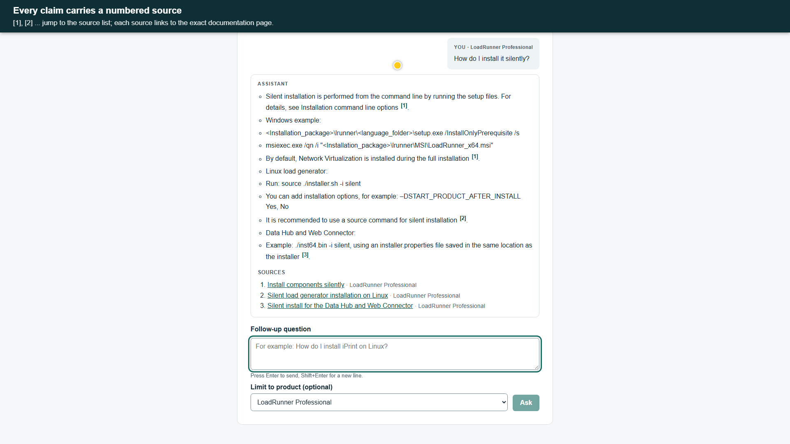

## Watch the demo

[](docs/demo/product-support-agent-demo.webm)

The [walkthrough](docs/demo/product-support-agent-demo.webm) (2 min 44 s, 1920x1080;
select the link to play it) shows the full page at normal zoom, in this order:

1. **Scope first.** A fixed sample of 100 OpenText products, of which **10** have
   documentation indexed (300 pages).
2. **The whole page.** The coverage table with pages and index dates for the 10
   indexed products, then the other 90 listed as not searchable.
3. **What it covers.** A starter question; the agent lists the products it can
   answer about.
4. **The product filter, open.** All 10 values are visible, and LoadRunner
   Professional is chosen before the question is asked.
5. **A cited answer.** Every claim has a numbered source that links to the exact
   documentation page.
6. **A follow-up question** that keeps the conversation context.
7. **A product that is not indexed**, which it says it cannot answer.
8. **A hostile prompt**, which is refused and produces no invented links.
9. **Monitoring.** The OpenTelemetry trace of a chat request, from the browser
   through the API, the agent, the search tool, and each model call.

To regenerate the video against a running stack, see
[scripts/demo/](scripts/demo/README.md).

## Key facts at a glance

| Question | Answer |
|---|---|
| What is this? | A grounded product-support assistant. Answers come only from indexed public documentation, and every claim cites a retrieved source. |
| What does it cover? | **10 of 100** sampled products (300 pages). It does not answer about the other 90 and says so. |
| Is it production ready? | No. It is a local demo; nothing is deployed to Azure. See the [production gap register](docs/operations/production-gap-register.md). |
| How good are the answers? | See [Evaluation results](#evaluation-results) for the measured results and their limits. |
| What did not work as specified? | See [Source deviation](#source-deviation-from-the-original-brief). |

## Executive summary

Product Support Agent is a local-first demonstration of a web and agentic
support assistant. It answers questions from anonymously accessible product
documentation, retrieves evidence from Azure AI Search, and returns links
resolved by the server from that evidence.

The browser calls only the TypeScript/Next.js server. Next.js calls the Python
FastAPI service, which uses Microsoft Foundry for chat and embeddings and Azure
AI Search for hybrid retrieval. MongoDB stores canonical documents and
ingestion state. Ingestion runs through a queue: one message per product on
Azure Storage Queue (Azurite locally), processed one at a time with each
product's outcome recorded. MongoDB and Azurite run in Podman, not in Azure.

The approved source map covers 10 of the 100 manifest products. It has ingested
300 pages and indexed 952 chunks. See [Evaluation results](#evaluation-results)
for the measured results and what they do and do not show.

This is a local demo, not a production service. The cloud application stack is
not deployed. Production-only controls and blocking triggers are listed in the
[production gap register](docs/operations/production-gap-register.md), and the
delivery boundaries are recorded in [ADR-0007](docs/architecture/decisions/adr-0007-demo-delivery-mode.md).

## Quick links by audience

| Audience | Start here |
|---|---|
| Executive and product stakeholders | This overview, [demo outcomes](docs/operations/phase-6-evaluation-v2.md), [implementation status](docs/implementation-plan.md), and [production gap register](docs/operations/production-gap-register.md) |
| Technical architects | [Architecture overview](docs/architecture/architecture-overview.md), [decision register](docs/architecture/decision-register.md), [ADRs](docs/architecture/decisions/), [risk assumptions](docs/architecture/risk-assumptions.md), and [security posture](docs/security/security-posture.md) |
| Developers | [Local development runbook](docs/operations/local-development.md), [environment configuration](#configuration-and-environment-variables), [backend](src/product_support_agent/), and [web app](apps/web/) |
| Quality assurance | [Test and evaluation guidance](#quality-assurance), [evaluation report](docs/operations/phase-6-evaluation-v2.md), [test suite](tests/), and [threat register](docs/security/threat-register.md) |

## Source deviation from the original brief

The brief asks the ingestion to use the product listing page and the search API,
with the feed as the fallback, and to skip anything that needs authentication.
What happened, checked against live responses:

| Source | Result | What the code does |
|---|---|---|
| `my.opentext.com/support/products/` (listing) | HTTP 200, but the page is client-rendered and has no usable product data | Treated as empty; the next source is tried |
| `.../api/web/support/search-results` | HTTP **401** for anonymous callers | Treated as protected: skipped, never retried with credentials, recorded in `CatalogOutcome.notes` |
| `.../api/web/feed/product` | HTTP 200 with 1,302 parseable products | Used as the catalog; `scripts/create_manifest.py` selects the 100 products |
| `my.opentext.com/support/products/{slug}` pages | Client-rendered, so they yielded no text and looked login-protected | Used only as the product's support-page link |
| Documentation sites (`docs.microfocus.com`, `admhelp.microfocus.com`) | Anonymous, documented delivery paths found for 10 of the 100 products | Ingested through a versioned [source map](docs/operations/phase-3-source-map-v1.json) |

Consequences you should know about:

* Only **10 of 100** products have indexed documentation. For the other 90, the
  status is "no approved public source found". That means this demo did not
  verify a public source for them, not that none exists.
* The product page content on `my.opentext.com` is not the source of answers.
  Answers come from the documentation sites above.
* Source terms and reuse rights are unverified, and that review is a production
  gate. See [ADR-0002](docs/architecture/decisions/adr-0002-source-access-and-manifest.md)
  and [ADR-0006](docs/architecture/decisions/adr-0006-periodic-resumable-source-ingestion.md).

To build a manifest from the catalog (it needs network access to
`my.opentext.com` and refuses to overwrite an existing file unless you pass
`--replace`):

```powershell
uv run python scripts/create_manifest.py --manifest-version opentext-YYYY-MM-DD-v2 --output docs/operations/manifest-new.json
```

## What "grounded" means here

The API response has a `grounded` flag. It is true when the answer kept at least
one citation whose URL came from this request's retrieved evidence. That makes
links trustworthy, because the server builds them and the model cannot invent
them. It does **not** prove every sentence is supported by its source. The
[evaluation](#evaluation-results) measures that separately with a model judge,
which is a screening check and not a guarantee.

## Evaluation results

The offline evaluation (`scripts/run_evaluation.py`, question set `phase-6-v2`)
has 15 answerable questions plus 6 that should be refused: 3 off-topic and 3
adversarial (prompt injection, a request to invent a link, an unsupported
claim). The latest report is
[phase-6-evaluation-v2.md](docs/operations/phase-6-evaluation-v2.md).

| Measure | Latest run | What it means | Limit |
|---|---:|---|---|
| Expected-source hit in top five | 12/15 (80.0%) | The page a person would expect is among the first five results | Small, synthetic set; 3 questions miss in every run |
| Citation validity | 17/17 (100%) | Every citation is a URL retrieved for that question | Checks links, not claims |
| Claim support | 10/12 (83.3%) | A judge model checks the answer against the full text of the pages it cites | Model-judged by the same model family that answers; needs human review |
| Refusals | 6/6 | Off-topic and adversarial questions get the standard refusal with no citations | 6 questions only |

**Results vary between runs.** Three full runs of the same set gave claim
support of 71.4%, 76.9%, and 83.3%, and refusals of 6/6, 5/6, and 6/6. The
first run cut the judge's source text at 12,000 characters, which produced at
least one false "unsupported" verdict, so the limit was raised. Only the latest
run meets the 80% claim-support target, so treat the target as **not reliably
met**. In the latest run three answerable questions returned no citations (the
agent declined to answer), which lowers the judged count instead of failing it.
Do not quote one run as a quality guarantee; the next steps are a larger
question set, repeated runs with a reported range, and human review of
judged answers.

## What the demo includes

* A Next.js chat interface with coverage disclosure, starter questions, a
  product filter, a conversation kept only in the browser tab, numbered source
  links beside each answer, and clear messages when it cannot answer.
* A FastAPI endpoint that coordinates Microsoft Agent Framework with two tools
  (`search_documentation` and `list_products`), hybrid search, request limits,
  metadata-only logs, and server-side citation binding.
* A resumable, request-bounded ingestion worker that reads only the versioned
  source map, respects source access controls, and keeps Azure AI Search in step
  with MongoDB (it indexes new pages and deletes removed ones in the same run).
* A synthetic evaluation set with answerable, off-topic, and adversarial
  questions, including a claim-support check.
* A Podman Compose stack that binds published ports to `127.0.0.1`.

The model is not allowed to supply citation URLs. Retrieved source text and
user input are untrusted. Query and response retention is disabled. See the
[threat register](docs/security/threat-register.md) and
[privacy impact assessment](docs/security/privacy-impact-assessment.md).

## Local demo prerequisites

* Windows PowerShell, Git, and Podman with a running Podman machine and a
  working `podman compose` provider.
* Network access from the developer machine to the configured Microsoft
  Foundry and Azure AI Search endpoints.
* An existing Microsoft Foundry deployment for chat and an embedding
  deployment, plus an Azure AI Search service.
* `uv` 0.13.9 or later for the evaluation and Python checks. Node.js is not
  required to run the containerized demo; it is required to work on the web app
  directly.
* For local development outside the containers, Python 3.11 or later and
  Node.js 22 or later.

The [local development runbook](docs/operations/local-development.md) contains
the clean-checkout setup, first-run ingestion and indexing, evaluation, and
data-preserving stop commands.

### Azure resources for a local-only demo

The application still calls two Azure services from the developer machine.
Only the Foundry models and Azure AI Search need to be provisioned in Azure for
the local demo. MongoDB and Azurite run locally in Compose.

| Azure service | Set up or verify | Values needed by this repository |
|---|---|---|
| Microsoft Foundry | Use an existing Foundry resource/project with a chat deployment (`gpt-5`) and an embedding deployment (`text-embedding-3-small`). Verify region availability, quota, and that both deployments are ready. Creating a resource or model deployment can incur cost and needs the appropriate authorization. | The OpenAI-compatible `.../openai/v1` endpoint, API key, and the exact chat and embedding deployment names |
| Azure AI Search | Use an existing Search service with vector-search support. The indexer script creates versioned `product-support-demo-*` indexes; a separate `product-support-test-*` index is used for opt-in live tests. Capture the service endpoint and an admin key for server-side indexing and query operations. Never put this key in browser code. | Search endpoint and admin API key; embedding model version and dimensions must match the Foundry embedding deployment (`1536` for the supplied example) |

The current Azure documentation lists vector search across service tiers, but
service quotas, capacity, pricing, and other features vary. Check current
regional availability and costs before creating or changing a service. Semantic
ranking was not evaluated for this demo because the Search tier and billing
plan could not be verified.

No Azure Storage account, MongoDB service, Container Apps, API Management,
virtual network, private endpoint, or Application Insights resource is needed
to run this local demo. Do not create new Azure resources, change SKUs, or
deploy new models without authorization. The project’s authorization boundary
is documented in [ADR-0007](docs/architecture/decisions/adr-0007-demo-delivery-mode.md).

Official setup references:

* [Create an Azure AI Search service](https://learn.microsoft.com/azure/search/search-create-service-portal)
* [Vector search in Azure AI Search](https://learn.microsoft.com/azure/search/vector-search-overview)
* [Create a Microsoft Foundry project and deploy a model](https://learn.microsoft.com/azure/foundry/tutorials/quickstart-create-foundry-resources)

### Start the stack

From the repository root, copy the example configuration only if you do not
already have a local `.env` file. Fill the Foundry and Search values in `.env`;
do not commit it or print its contents:

```powershell
if (-not (Test-Path .env)) { Copy-Item .env.example .env }
```

The chat client does not send a temperature parameter to `gpt-5` or other
reasoning deployments. Query/response retention is not implemented and remains
off.

Start the Podman machine if it is stopped, then build and start the services:

```powershell
podman machine list
# Run only when the machine is stopped:
podman machine start
podman compose up --build -d
```

Open [http://127.0.0.1:3000](http://127.0.0.1:3000). Check the API at
[http://127.0.0.1:8000/healthz](http://127.0.0.1:8000/healthz) and coverage at
[http://127.0.0.1:8000/catalog/coverage](http://127.0.0.1:8000/catalog/coverage).
The browser never calls FastAPI directly.

If the local MongoDB volume is empty, run a queue-driven ingestion pass. It
queues one message per manifest product, ingests each product, indexes its pages
into Azure AI Search, and records the outcome for every product:

```powershell
podman compose run --rm api python scripts/run_queue_ingestion.py run
podman compose run --rm api python scripts/run_queue_ingestion.py status
```

This uses only the approved source map, robots policy, freshness checks, request
budget, and backoff. Pages fetched in the last 24 hours are skipped, so a rerun
makes no requests. `scripts/run_source_ingestion.py` runs the same worker
without the queue, and `scripts/index_documents.py` rebuilds the Search index
from MongoDB. Ingestion uses real public sources and configured Foundry
deployments, so follow the budgets and limits in the
[local runbook](docs/operations/local-development.md).

Stop the project while preserving its MongoDB and Azurite volumes:

```powershell
podman compose stop --timeout 30
```

Do not use `podman compose down --volumes` unless you intend to delete local
data. See the runbook for restart and cleanup details.

## Configuration and environment variables

`.env.example` is the canonical template. The table covers the variables in
that file plus runtime and script aliases used by the repository. Values shown
in the template are examples; edit a local `.env` and never commit credentials.
Compose passes `.env` only to the API container and overrides the MongoDB and
manifest/source-map paths for the container network. Query/response retention
is not implemented in the demo and must remain off.

### Ingestion queue

| Variable | Purpose and local-demo guidance |
|---|---|
| `PRODUCT_SUPPORT_QUEUE_CONNECTION_STRING` | Queue connection string. Compose sets Azurite's published development key; do not use a real storage key here. `PRODUCT_SUPPORT_AZURITE_QUEUE_CONNECTION_STRING` is accepted as an alias. |
| `PRODUCT_SUPPORT_QUEUE_ACCOUNT_URL` | Azure: the storage account queue URL. The job signs in with its managed identity; shared keys are disabled on the account. |
| `PRODUCT_SUPPORT_QUEUE_API_VERSION` | Storage API version for the queue client. Compose pins `2026-06-06`, the newest version Azurite 3.38 accepts. Leave unset in Azure. |
| `PRODUCT_SUPPORT_INGESTION_QUEUE_NAME` | Queue name, default `product-ingestion`. The poison queue is this name plus `-poison`. |
| `PRODUCT_SUPPORT_POISON_DEQUEUE_COUNT` | Deliveries before a message is moved to the poison queue, default 5. |

### Catalog workflow

These settings configure catalog discovery. They are not needed for normal
chat startup or the source-map-based documentation ingestion job. The
ingestion queue settings are listed under
[Ingestion queue](#ingestion-queue).

| Variable | Purpose and local-demo guidance |
|---|---|
| `PRODUCT_SUPPORT_CATALOG_LISTING_URL` | Product listing endpoint used by catalog discovery. |
| `PRODUCT_SUPPORT_CATALOG_SEARCH_URL` | Catalog search endpoint. Do not add authentication or bypass access controls. |
| `PRODUCT_SUPPORT_CATALOG_FEED_URL` | Catalog feed endpoint used by the catalog fallback. |
| `PRODUCT_SUPPORT_CATALOG_MAX_PAGES` | Maximum catalog pages to process. |
| `PRODUCT_SUPPORT_CATALOG_TIMEOUT_SECONDS` | Timeout for catalog HTTP requests. |
| `PRODUCT_SUPPORT_CATALOG_MAX_RESPONSE_BYTES` | Maximum catalog response body size. |
| `PRODUCT_SUPPORT_MAX_DEMO_PRODUCTS` | Maximum manifest size; hard-limited to 100. |
| `PRODUCT_SUPPORT_MANIFEST_SEED` | Stable seed used when selecting a reproducible manifest sample. |

### Source ingestion and local storage

| Variable | Purpose and local-demo guidance |
|---|---|
| `PRODUCT_SUPPORT_MANIFEST_PATH` | Approved product manifest JSON path. Compose overrides it with the path copied into the API image. |
| `PRODUCT_SUPPORT_SOURCE_MAP_PATH` | Approved documentation source map JSON path. Compose overrides it with the path copied into the API image. |
| `PRODUCT_SUPPORT_MONGODB_URI` | MongoDB connection string. Use `mongodb://127.0.0.1:27017` from the host; Compose overrides it inside the API container to `mongodb://mongodb:27017`. |
| `PRODUCT_SUPPORT_SOURCE_USER_AGENT` | User-Agent sent by the bounded source ingestion worker. |
| `PRODUCT_SUPPORT_SOURCE_REQUEST_BUDGET` | Maximum HTTP requests per ingestion run; default 400, hard maximum 2,000. |
| `PRODUCT_SUPPORT_SOURCE_MIN_REQUEST_INTERVAL_SECONDS` | Minimum delay between requests to a host. The configured minimum is one second. |
| `PRODUCT_SUPPORT_SOURCE_MAX_RETRY_AFTER_SECONDS` | Maximum delay honored from a source `Retry-After` header. |
| `PRODUCT_SUPPORT_SOURCE_SUCCESS_FRESHNESS_HOURS` | Period during which a successfully fetched page is reused without another request. |
| `PRODUCT_SUPPORT_SOURCE_TRANSIENT_FAILURE_BACKOFF_HOURS` | Backoff after a transient source failure. |
| `PRODUCT_SUPPORT_SOURCE_PERMANENT_FAILURE_BACKOFF_DAYS` | Backoff after a permanent or protected-source failure. |
| `PRODUCT_SUPPORT_SOURCE_FAIL_FAST_CONSECUTIVE_FAILURES` | Consecutive page failures before the worker stops processing that product. |

### Foundry models and chat

| Variable | Purpose and local-demo guidance |
|---|---|
| `AZURE_OPENAI_ENDPOINT` | Foundry OpenAI-compatible chat endpoint, ending in `/openai/v1`. |
| `AZURE_OPENAI_API_KEY` | Key used by the server for Foundry chat and embeddings. Keep it in `.env` only. |
| `AZURE_OPENAI_CHAT_DEPLOYMENT` | Exact Foundry chat deployment name. The template uses `gpt-5`. |
| `AZURE_OPENAI_EMBEDDING_DEPLOYMENT` | Exact Foundry embedding deployment name. The template uses `text-embedding-3-small`. |
| `AZURE_OPENAI_EMBEDDING_ENDPOINT` | OpenAI-compatible embedding endpoint. Use the endpoint for the configured Foundry resource. |

Chat requests do not include a temperature parameter because `gpt-5` and other
reasoning deployments reject it.

### Azure AI Search

| Variable | Purpose and local-demo guidance |
|---|---|
| `AZURE_AI_SEARCH_ENDPOINT` | Azure AI Search service endpoint, such as `https://<service>.search.windows.net`. |
| `AZURE_AI_SEARCH_API_KEY` | Server-side Search key used by the application for indexing and retrieval. Keep it out of browser code and source control. |
| `PRODUCT_SUPPORT_SEARCH_EMBEDDING_MODEL_VERSION` | Embedding model identifier included in the versioned Search index configuration. |
| `PRODUCT_SUPPORT_SEARCH_EMBEDDING_DIMENSIONS` | Vector size expected by the Search schema; use `1536` for `text-embedding-3-small` in this demo. |
| `PRODUCT_SUPPORT_SEARCH_DEMO_INDEX_BASE` | Base name for the versioned demo index. Keep it under the `product-support-*` namespace. |
| `PRODUCT_SUPPORT_SEARCH_TEST_INDEX_BASE` | Base name for disposable live-test indexes. Keep it under the `product-support-test-*` namespace. |

### Additional runtime and script settings

| Variable | Purpose and local-demo guidance |
|---|---|
| `PRODUCT_SUPPORT_API_BASE_URL` | Server-side URL used by Next.js to call FastAPI. Compose sets `http://api:8000`; when running Next.js on the host, use `http://127.0.0.1:8000`. Never expose it as a `NEXT_PUBLIC_*` variable. |
| `PRODUCT_SUPPORT_SEARCH_ENDPOINT` | Optional Search endpoint alias. `scripts/apply_search_index.py` requires this variable. It can also override `AZURE_AI_SEARCH_ENDPOINT` in application settings. |
| `PRODUCT_SUPPORT_SEARCH_ADMIN_KEY` | Optional Search admin-key alias. `scripts/apply_search_index.py` requires this variable; it can also override `AZURE_AI_SEARCH_API_KEY`. |
| `PRODUCT_SUPPORT_EMBEDDING_BASE_URL` | Optional alias that overrides `AZURE_OPENAI_EMBEDDING_ENDPOINT` in application settings. |
| `PRODUCT_SUPPORT_EMBEDDING_API_KEY` | Optional alias that overrides `AZURE_OPENAI_API_KEY` for embedding requests. |

## Repository structure

```text
product-support-agent/
├── .github/
│   ├── agents/                 # Repository-specific Copilot agents
│   ├── instructions/           # Python, Bicep, and CI security guidance
│   ├── licenses/               # Third-party license notices
│   ├── prompts/                # Review and threat-model prompts
│   ├── skills/
│   │   └── microsoft-agent-framework/ # Agent Framework project guidance
│   └── workflows/              # Validation, infrastructure, and app workflows
├── apps/
│   └── web/                    # Next.js app, package lock, and build configuration
│       └── src/
│           ├── app/            # Pages, server route handlers, and styles
│           ├── components/     # Chat and UI components
│           └── lib/            # Server-side API clients and helpers
├── docs/
│   ├── architecture/           # Architecture, decisions, risks, and requirements
│   │   └── decisions/          # ADRs
│   ├── chat-sessions/          # Sanitized conversation records
│   ├── operations/             # Runbooks, manifests, source map, and evaluation
│   └── security/               # Threat model, privacy, and security posture
├── scripts/                    # Ingestion, indexing, evaluation, and maintenance
├── src/
│   └── product_support_agent/  # Python domain logic and FastAPI backend
│       └── api/                # HTTP application and endpoint wiring
├── tests/
│   ├── evaluation/             # Versioned evaluation questions
│   ├── integration/            # Opt-in live Search integration tests
│   └── unit/                   # Offline deterministic tests
├── .env.example                # Documented local environment template
├── Containerfile               # API container image
├── apps/web/Containerfile      # Web container image
├── compose.yaml                # Loopback-bound local demo stack
├── Instructions.md             # Product requirements and project constraints
├── pyproject.toml              # Python dependencies and tool configuration
└── uv.lock                     # Locked Python dependency graph
```

The Azure architecture is authored as design-only Bicep in [infra/](infra/README.md);
it has not been deployed. See the [IaC workflow](.github/workflows/infra.yml),
[application workflow](.github/workflows/app.yml), and
[infrastructure diagram](docs/architecture/diagrams/azure-infrastructure.drawio.svg)
alongside the [architecture overview](docs/architecture/architecture-overview.md).

## Architecture and data flow

1. The source worker reads only
   [`phase-3-source-map-v1.json`](docs/operations/phase-3-source-map-v1.json)
   and stores permitted canonical pages and fetch state in local MongoDB. In
   the same run it creates or updates the versioned Azure AI Search index,
   writes chunks and vectors using the Foundry embedding deployment, and
   deletes pages that left the selection from both stores. Use
   `--repository-only` to skip Search. `scripts/index_documents.py` rebuilds
   the index from MongoDB, for example after an embedding model change.
3. The browser sends chat requests to Next.js. The server-side route calls
   FastAPI; the agent retrieves filtered evidence from Azure AI Search (or
   looks up the product catalog) and calls the Foundry chat deployment.
4. The API binds cited evidence IDs to retrieved source URLs and numbers them
   by first use. The UI renders answers as plain text with linked markers, and
   the source links come only from the citation list.

Ingestion is queue-driven (`scripts/run_queue_ingestion.py`):

1. **Enqueue.** One message per manifest product with an approved source. Each
   message carries only the run ID and a product reference. Products without a
   source are recorded at once as skipped, with the reason `no_public_source`.
2. **Work.** The worker takes one message, runs the source worker for that
   product, writes the outcome (`success`, `partial`, `skipped`, `failed`, or
   `dead_letter`) and page counts to MongoDB, then deletes the message.
3. **Recover.** A worker that crashes before the delete leaves the message, which
   reappears after the 15-minute visibility timeout; reprocessing is idempotent.
   A message delivered five times moves to `product-ingestion-poison`. If the
   request budget runs out, the product is requeued with a one-hour delay.
4. **Report.** The run completes when every product has an outcome. Read it with
   `run_queue_ingestion.py status` or `GET /ingestion/runs/latest`.

The last local run recorded all 100 products: 10 succeeded and 90 were skipped
as having no approved public source. Both queues were empty afterwards.

The OpenText Service Management expansion is a design only; see
[service-management-expansion.md](docs/architecture/service-management-expansion.md).

See the [architecture overview](docs/architecture/architecture-overview.md)
for diagrams and [ADR-0005](docs/architecture/decisions/adr-0005-ui-and-backend-technology.md)
for the UI/backend boundary.

## Quality assurance

Install the Python development dependencies from the repository root:

```powershell
uv sync --all-groups
```

Routine Python validation is offline by default:

```powershell
uv run ruff format --check .
uv run ruff check .
uv run mypy src/product_support_agent scripts
uv run pytest
uv run bandit -q -r src scripts
```

For web changes, run from `apps/web`:

```powershell
npm ci
npm run lint
npm run typecheck
npm run build
```

The default pytest configuration excludes live tests. The marked Search
integration test creates a dedicated `product-support-test-*` index and removes
it after the test:

```powershell
uv run pytest -m live
```

Run the local evaluation after Compose is healthy:

```powershell
uv run python scripts/run_evaluation.py --api-url http://127.0.0.1:8000
```

See the [evaluation report](docs/operations/phase-6-evaluation-v2.md) for the
current baseline and [implementation plan](docs/implementation-plan.md) for
phase completion evidence.

## Key documentation

* [Local development runbook](docs/operations/local-development.md): setup,
  environment, ingestion, indexing, chat, evaluation, and teardown.
* [Implementation plan](docs/implementation-plan.md): scope, work packages,
  phase statuses, evidence, and production-only notes.
* [Architecture overview](docs/architecture/architecture-overview.md): system
  context, components, data ownership, and trust boundaries.
* [Decision register](docs/architecture/decision-register.md) and
  [architecture decision records](docs/architecture/decisions/): accepted
  choices and rationale.
* [Threat register](docs/security/threat-register.md),
  [privacy impact assessment](docs/security/privacy-impact-assessment.md), and
  [security posture](docs/security/security-posture.md): trust, privacy, and
  security controls.
* [Production gap register](docs/operations/production-gap-register.md):
  production work, owners, and blocking triggers.