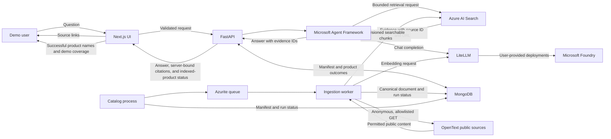
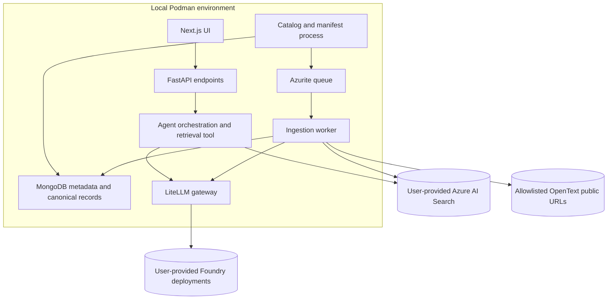
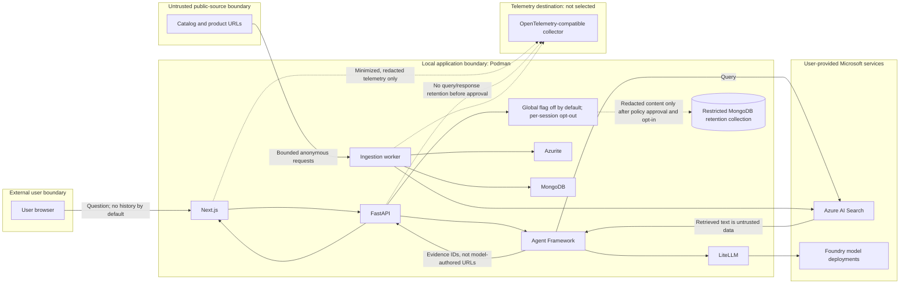
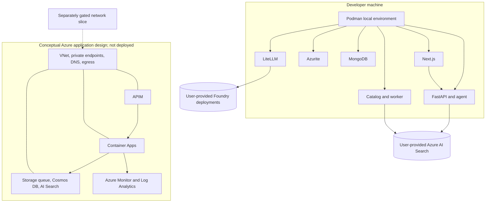

## Status

The Phase 0 direction is approved. These diagrams reflect the approved local
MVP direction and Phase 0b privacy request; they are not implementation or
deployment evidence. See the [decision register](./decision-register.md).

## System context

## Proposed logical containers

The boxes below describe logical responsibilities. They do not decide whether
the UI, API, and worker run as separate local processes or deployment units.

## Data flow and trust boundaries

Retrieved text, user input, model output, and external source instructions are
untrusted. The application must validate URLs and tool arguments, bind citations
to retrieved evidence, and exclude query/response content from telemetry until a
privacy policy is approved.

## Deployment view

The local demo uses Azure AI Search and Foundry supplied by the user. The
application stack is not deployed to Azure. A network slice is a distinct,
later-approved activity described in Phase 7 of the
[implementation plan](../implementation-plan.md).

## Local-to-cloud component mapping

| Local MVP | Conceptual Azure counterpart | Important difference or limit |
|---|---|---|
| Next.js UI | Container App | Application deployment is deferred; cloud user authentication is not yet decided. |
| FastAPI and agent | Container App | Cloud identity and APIM behavior require Phase 7 validation. |
| Ingestion worker | Container App with queue-based scaling | External-source egress must be allowlisted and bounded. |
| LiteLLM | Azure API Management | Not assumed to be behaviorally equivalent; model routing, policy, identity, and telemetry need an ADR. |
| MongoDB | Cosmos DB for MongoDB | Authentication and feature compatibility must be verified for the selected API/model. |
| Azurite Queue | Azure Storage Queue | Poison-message and completion tracking need application-level handling. |
| Azure AI Search | Azure AI Search | Same provider in both environments. Local access uses the service's public endpoint; the cloud design uses a private endpoint. |
| No cache in the MVP | Azure Cache for Redis only if justified | Caching is deferred until measurements show a need. |
| Local OpenTelemetry-compatible collector, not selected | Azure Monitor and Log Analytics | Local destination and retention remain open; query/response content is excluded until privacy approval. |

## References

* [Microsoft Agent Framework overview](https://learn.microsoft.com/agent-framework/overview/)
* [Azure AI Search hybrid search](https://learn.microsoft.com/azure/search/hybrid-search-overview)
* [Azure AI Search vector quickstart](https://learn.microsoft.com/azure/search/search-get-started-vector)
