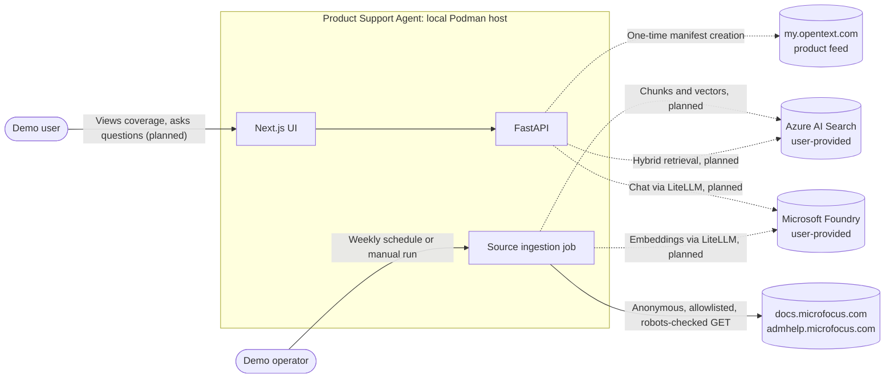
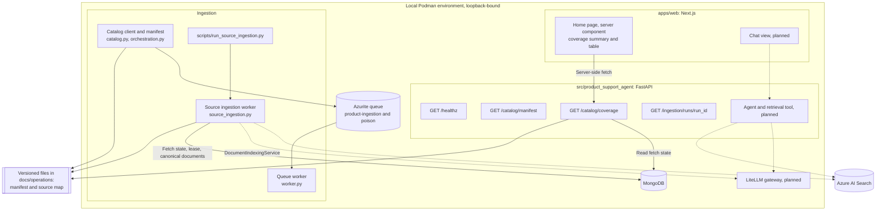
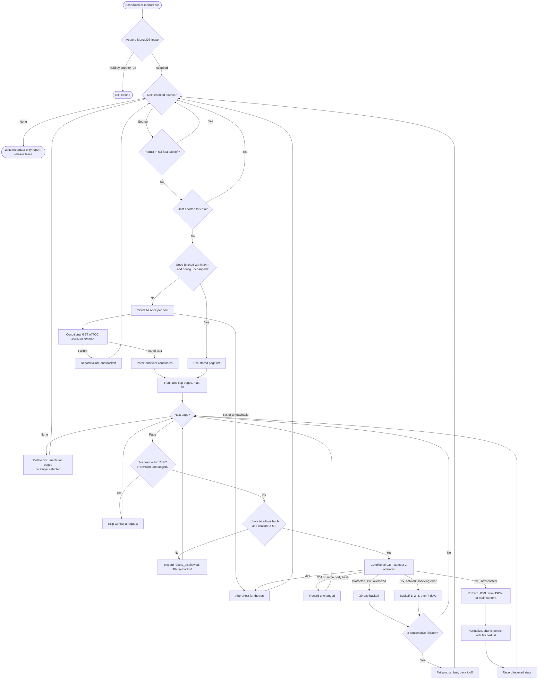
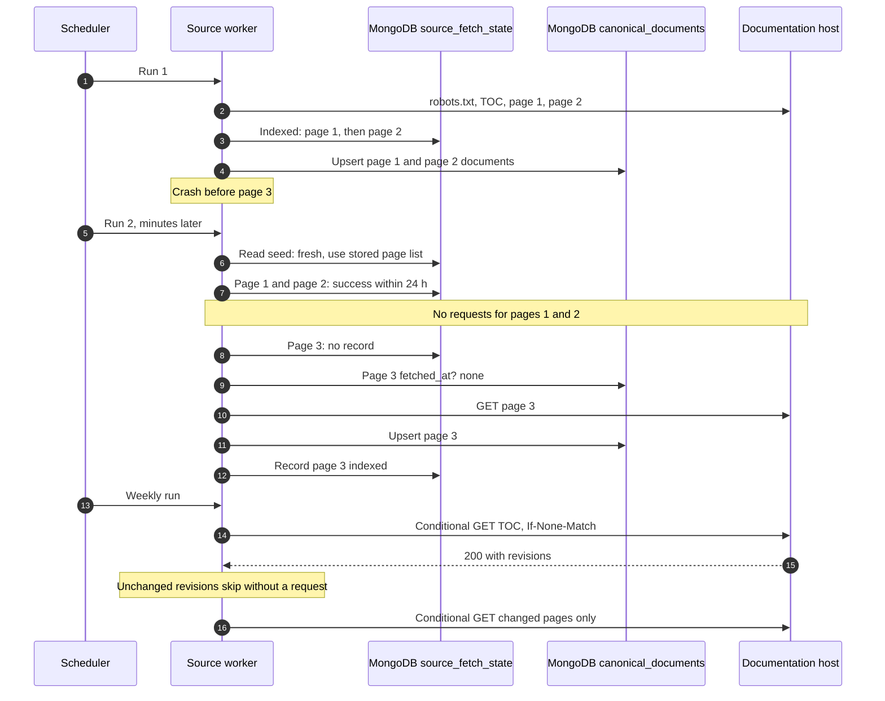
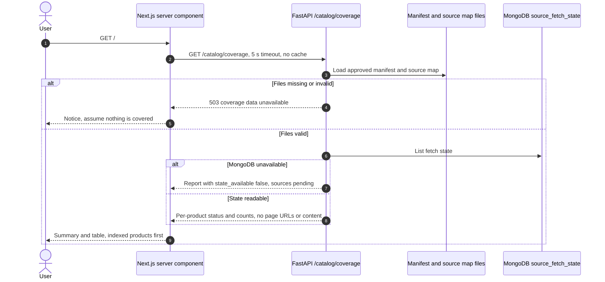
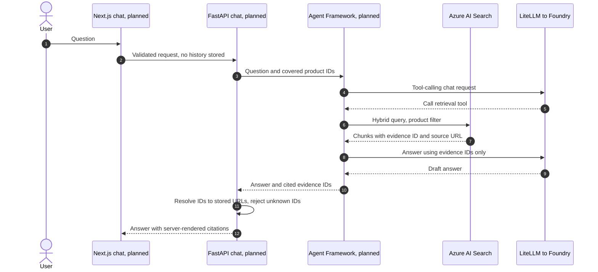
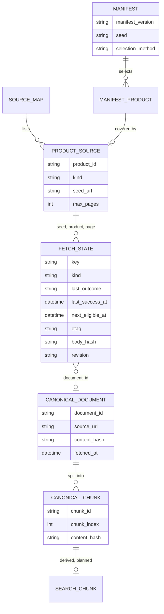
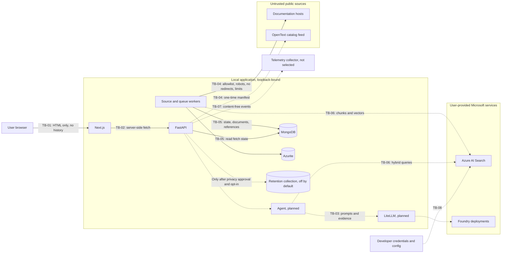
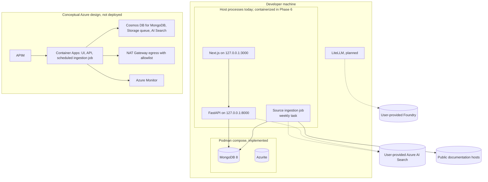

## Status

Each diagram marks components as **implemented** (code and tests exist) or
**planned** (later phase). Implemented components are tested offline unless the
[implementation plan](../implementation-plan.md) records a live verification.

| Area | State on 2026-11-22 |
|---|---|
| Catalog discovery, manifest, queue contract, Phase 2 worker | Implemented (Phase 2, approved) |
| Source map, periodic source worker, fetch state, coverage API and UI | Implemented, tested offline ([ADR-0006](decisions/adr-0006-periodic-resumable-source-ingestion.md)) |
| Canonical documents and chunks in MongoDB | Implemented; no live content ingested |
| Azure AI Search index, hybrid retrieval provider | Implemented; test-index definition applied, no documents uploaded |
| Embeddings through LiteLLM | Interface only; no deployment configured |
| Agent, chat API, citations, chat UI | Planned (Phases 4 and 5) |
| Telemetry, evaluation, query/response retention | Planned and gated (Phase 6, privacy approval) |
| Azure deployment | Design-only (Phase 7) |

Legend: solid lines and boxes are implemented; dashed lines or boxes marked
*planned* are not built yet.

## System context

The OpenText product pages are a catalog source only. They render in the
browser and lead to login-gated knowledge bases. Product documentation comes
from the explicitly listed seeds in the
[source map](../operations/phase-3-source-map-v1.json).

## Containers and components

The browser talks only to Next.js. The home page fetches `/catalog/coverage` on
the server, using `PRODUCT_SUPPORT_API_BASE_URL` (default
`http://127.0.0.1:8000`), so the API needs no CORS configuration and stays on
loopback.

## Documentation ingestion process

A run processes each enabled source map entry in order. Every request is
counted against the run's budget and spaced at least 1 second apart per host.

Each request's state is written to `source_fetch_state` as soon as the request
finishes. A restarted run therefore skips URLs that succeeded within the
freshness window. If that write was lost, the canonical document's `fetched_at`
is a second guard.

## Restart and resume sequence

## Coverage disclosure flow

Product statuses are `indexed`, `pending` (approved source, nothing indexed
yet), `unavailable` (the seed or the product is backing off), `excluded`
(disabled in the source map), and `no_public_source`.

## Planned grounded chat flow

Retrieved text is untrusted data. The model may cite only evidence IDs; the
server resolves them to canonical URLs.

## Data ownership

| Data | Owner and location | Notes |
|---|---|---|
| Manifest, source map | Versioned JSON in `docs/operations/`, reviewed in git | Changing either requires a new version |
| Fetch state, run lease | MongoDB `source_fetch_state`, `ingestion_leases` | Decides what to fetch; never contains page content |
| Canonical documents and chunks | MongoDB `canonical_documents`, `canonical_chunks` | System of record; not committed to git |
| Searchable chunks and vectors | Azure AI Search, versioned index | Derived; rebuilt from MongoDB |
| Queue messages | Azurite | Product references only |
| Run and coverage reports | JSON output, API responses | Outcomes and counts only |

## Trust boundaries

Edge labels use the boundary IDs from the
[threat register](../security/threat-register.md#trust-boundaries).

Source text, user input, and model output are untrusted. TB-09, the cloud
application boundary, is design-only and is shown in the deployment view.

## Deployment view

The application stack is not deployed to Azure. A network slice is a distinct,
later-approved activity described in Phase 7 of the
[implementation plan](../implementation-plan.md).

## Local-to-cloud component mapping

| Local MVP | Conceptual Azure counterpart | Important difference or limit |
|---|---|---|
| Next.js UI | Container App | Application deployment is deferred; cloud user authentication is not yet decided. |
| FastAPI and agent | Container App | Cloud identity and APIM behavior require Phase 7 validation. |
| Source ingestion job, weekly task | Container Apps job on a cron schedule | Egress must be allowlisted; the MongoDB lease keeps runs single-instance. |
| Catalog process and queue worker | Container App with queue-based scaling | Used for manifest creation; not needed for weekly documentation refresh. |
| LiteLLM | Azure API Management | Not assumed to be behaviorally equivalent; needs an ADR. |
| MongoDB | Cosmos DB for MongoDB | Authentication, `tz_aware` datetimes, and atomic upserts for the lease must be verified. |
| Azurite Queue | Azure Storage Queue | Poison-message and completion tracking need application-level handling. |
| Azure AI Search | Azure AI Search | Same provider. Local access uses the public endpoint; the cloud design uses a private endpoint. |
| No response cache | Azure Cache for Redis only if justified | Source fetch state is an idempotency control, not a cache. |
| Collector not selected | Azure Monitor and Log Analytics | Query and response content is excluded until privacy approval. |

## References

* [ADR-0002 Source access and manifest](decisions/adr-0002-source-access-and-manifest.md)
* [ADR-0006 Periodic, resumable documentation ingestion](decisions/adr-0006-periodic-resumable-source-ingestion.md)
* [Microsoft Agent Framework overview](https://learn.microsoft.com/agent-framework/overview/)
* [Azure AI Search hybrid search](https://learn.microsoft.com/azure/search/hybrid-search-overview)
* [RFC 9309 Robots Exclusion Protocol](https://www.rfc-editor.org/rfc/rfc9309)
