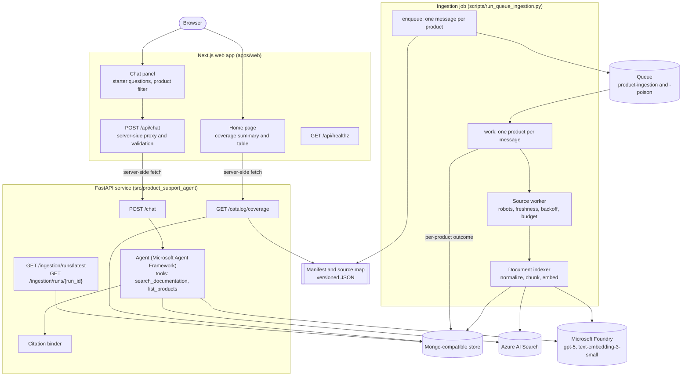
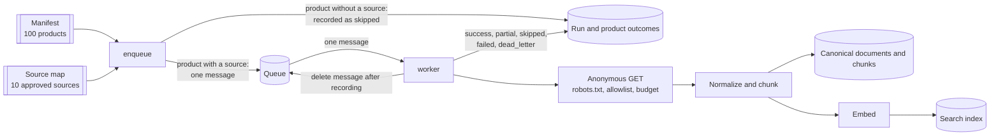
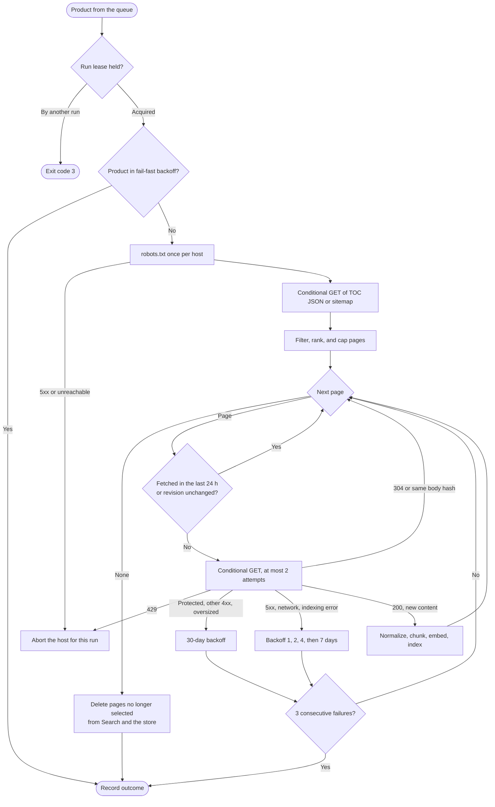
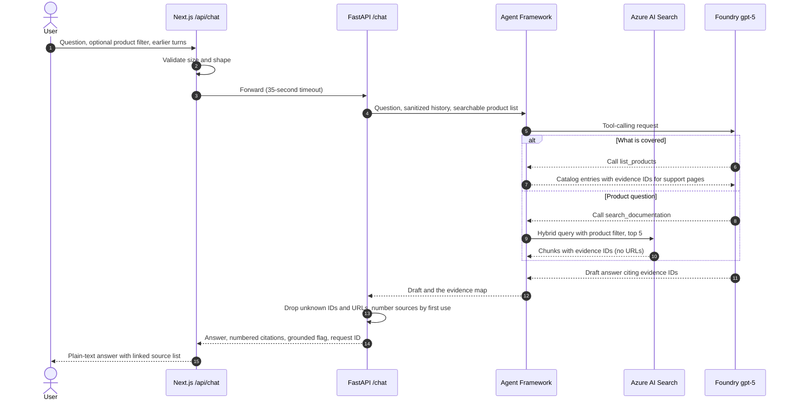
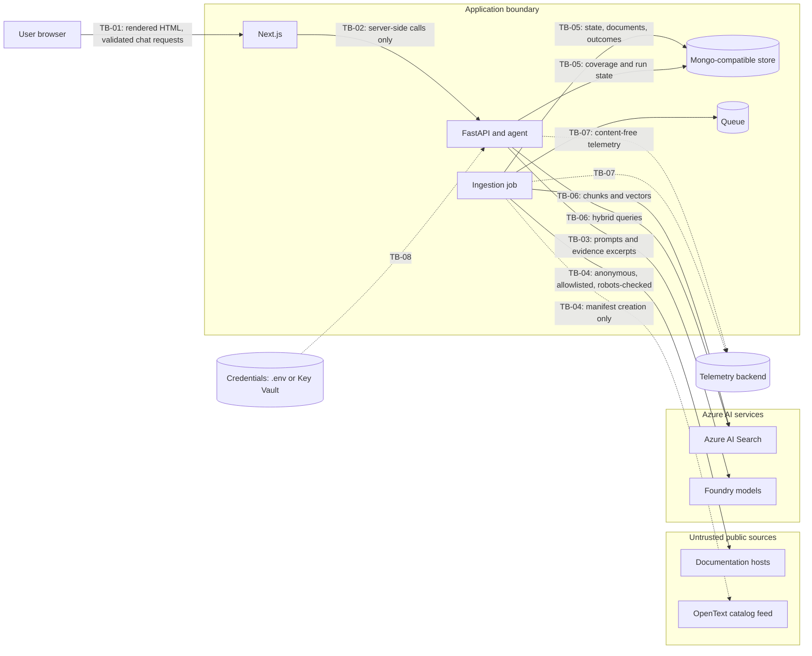
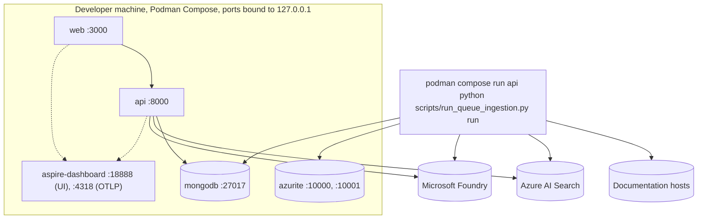
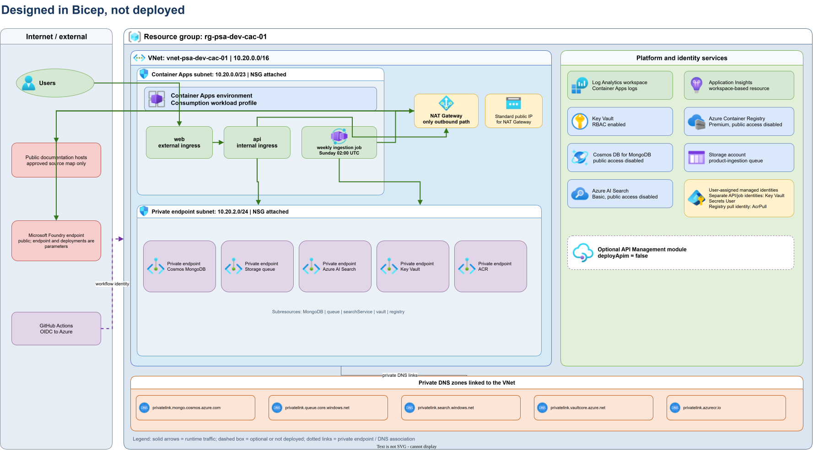

This document describes the solution as it is built. Each section answers one
of the questions in the original brief ([Instructions.md](../../Instructions.md)).
Decisions and their reasons are in the [decision register](decision-register.md)
and the [ADRs](decisions/). Open work is in the
[production gap register](../operations/production-gap-register.md).

## Purpose and scope

Product Support Agent answers questions about OpenText products from their
public documentation, and cites the exact page behind every claim.

* **Catalog.** A fixed, reproducible sample of 100 products drawn from the
  OpenText product feed.
* **Content.** Public documentation for the 10 sampled products that have an
  approved anonymous documentation source: 300 pages from
  `docs.microfocus.com` and `admhelp.microfocus.com`. The other 90 products are
  listed as not covered, and the assistant says so instead of answering.
* **Access.** Anonymous requests only. A source that answers HTTP 401 or 403,
  redirects to a sign-in page, or returns sign-in content is skipped and never
  retried with credentials.
* **Out of scope.** End-user sign-in, retention of questions and answers, and
  OpenText Service Management. The Service Management expansion is designed in
  [service-management-expansion.md](service-management-expansion.md).

## Application components

| Component | Code | Responsibility |
|---|---|---|
| Web app | `apps/web` | Renders coverage and the chat panel. Calls the API only from the server, so the browser never reaches FastAPI and no CORS is needed. Validates chat requests before forwarding them. |
| API | `src/product_support_agent/api/app.py` | Coverage, chat, and ingestion-run endpoints. Bounds chat with a 30-second timeout and four concurrent requests. |
| Agent | `src/product_support_agent/chat.py` | Runs the model with two tools, `search_documentation` and `list_products`, then binds the answer's evidence IDs to retrieved URLs. |
| Catalog | `catalog.py`, `product_catalog.py`, `scripts/create_manifest.py` | Discovers the product catalog (listing, then search API, then feed; protected sources skipped) and selects the 100-product manifest. |
| Ingestion | `queue_ingestion.py`, `source_ingestion.py`, `indexing.py` | Queue-driven, resumable fetching of approved pages, normalization into canonical documents and chunks, and indexing into Azure AI Search. |
| Retrieval | `search.py` | Hybrid keyword and vector search with product filters. |
| Telemetry | `telemetry.py`, `apps/web/src/instrumentation.ts` | OpenTelemetry traces, metrics, and logs with no question or answer text. |
| Infrastructure | `infra/bicep` | Azure network, data, identity, Container Apps, optional Foundry and API Management. |
| Pipelines | `.github/workflows` | Validation, image build and publish, infrastructure what-if and deployment. |

## Data flow

### Ingestion

1. **Enqueue.** One message per manifest product that has an approved source.
   A message carries only the run ID and a product reference. Products without
   a source are recorded at once as skipped, with the reason
   `no_public_source`, so every run accounts for all 100 products.
2. **Work.** The worker takes one message, ingests that product, records its
   outcome and page counts, and only then deletes the message.
3. **Recover.** A worker that stops before the delete leaves the message, which
   reappears after the 15-minute visibility timeout. Reprocessing is idempotent
   because fetch state and content hashes skip unchanged pages. A message
   delivered five times moves to the `-poison` queue. If the request budget
   runs out, the product is requeued with a one-hour delay.
4. **Report.** The run is complete when every product has an outcome.

Per page, the worker applies these rules:

Each request's state is written as soon as it finishes, so a restarted run
skips pages that succeeded within the freshness window. Every request counts
against the run's budget (400 by default, at most 2,000) and requests to one
host are at least one second apart.

### Coverage

The home page calls `GET /catalog/coverage` on the server with a 5-second
timeout. The API combines the manifest, the source map, and fetch state into a
status per product: `indexed`, `pending` (approved source, nothing indexed
yet), `unavailable` (the source is backing off), `excluded` (disabled in the
source map), or `no_public_source`. The response carries no page content or
page URLs. If coverage cannot be loaded, the page says that no product should
be assumed to be covered.

### Data ownership

| Data | Location | Notes |
|---|---|---|
| Manifest and source map | Versioned JSON in `docs/operations/`, reviewed in git | Runtime inputs. Changing either requires a new version. |
| Canonical documents and chunks | Store: `canonical_documents`, `canonical_chunks` | System of record for indexed content. |
| Fetch state and run lease | Store: `source_fetch_state`, `ingestion_leases` | Decides what to fetch; never contains page content. |
| Ingestion runs and product outcomes | Store: `ingestion_runs`, `product_ingestion_status` | Counts, outcomes, and reason categories only. |
| Search chunks and vectors | Azure AI Search, versioned index name | Derived; can be rebuilt from the store with `scripts/index_documents.py`. |
| Queue messages | Azurite locally, Azure Storage Queue in Azure | Run ID and product reference only; deleted once the outcome is recorded. |
| Chat conversation | The browser tab only | Not stored on the server. |
| Telemetry | Aspire dashboard locally, Application Insights in Azure | Metadata only: IDs, outcomes, counts, timings, token totals. |

The store is MongoDB 8 locally. In Azure it is Azure Cosmos DB for MongoDB
(request units) by default, or Azure DocumentDB Free when
`useDocumentDbFreeTier=true`.

## Model interaction

* **Models.** `gpt-5` (version `2025-08-07`) for chat and
  `text-embedding-3-small` (1,536 dimensions) for embeddings, called through
  Foundry's OpenAI-compatible endpoint. The chat client sends no temperature,
  which reasoning models reject.
* **Tools.** `search_documentation` runs hybrid retrieval and returns evidence
  IDs, titles, excerpts, and product IDs, never URLs. `list_products` returns
  the searchable products, or matches for a product name, with evidence IDs for
  their support pages.
* **Grounding.** The model may cite only evidence IDs returned in the same
  request. The server replaces them with the stored URLs, removes any other URL
  or Markdown link the model wrote, and numbers the sources. If no valid
  citation remains, the answer becomes "No indexed documentation answers this."
* **What `grounded` means.** The response flag is true when at least one
  citation survived binding. It proves the links are real; it does not prove
  every sentence is supported. The [evaluation](../operations/phase-6-evaluation-v2.md)
  checks claim support separately with a model judge.
* **Limits.** 2,000 characters per question, 8 earlier turns of at most 4,000
  characters each, 4 tool calls per question, a 30-second answer timeout, and 4
  concurrent chat requests per API instance. Earlier turns lose their citation
  markers and URLs before reuse, so an old evidence ID cannot be replayed.
* **Content safety.** If the model provider's content filter blocks a request,
  the user gets the standard refusal and the outcome is logged as
  `content_filtered`.
* **Retrieval.** Hybrid keyword and vector search (HNSW, cosine similarity),
  top 5 results by default, with vector candidates widened to four times the
  requested count. Semantic ranking is off.

## Identity and access

| Caller | Target | How it authenticates | Where |
|---|---|---|---|
| End user | Web app | None. The demo is anonymous. | Local and Azure |
| Web app | API | Network position only: server-side call on the Compose network or the Container Apps internal ingress | Local and Azure |
| API and ingestion job | Foundry and Azure AI Search | API keys. Locally from `.env`; in Azure from Key Vault secret references | Local and Azure |
| API and ingestion job | Key Vault | User-assigned managed identity, Key Vault Secrets User role | Azure |
| Ingestion job | Storage Queue | User-assigned managed identity, Storage Queue Data Message Sender and Processor roles. Shared keys are disabled on the account. | Azure |
| API and ingestion job | Application Insights | Managed identity, Monitoring Metrics Publisher role | Azure |
| Container Apps | Container registry | Separate pull identity, AcrPull role | Azure |
| API clients | API Management | Subscription key (`Ocp-Apim-Subscription-Key`) | Azure, optional |
| GitHub Actions | Azure | OpenID Connect federation, no client secret, one GitHub environment per Azure environment | CI/CD |

Each role assignment is scoped to a single resource. Search and Foundry still
use keys because their data planes are reached with key credentials in this
version; moving them to managed identity is listed in the
[production gap register](../operations/production-gap-register.md).

## Trust boundaries

Source text, user input, earlier conversation turns, and model output are all
treated as untrusted. Boundary IDs match the
[threat register](../security/threat-register.md#trust-boundaries).

In Azure the application boundary is the virtual network (TB-09): the API and
all data services are private, and only the web app and the optional API
Management gateway are public.

## Deployment

### Local

Only Foundry and Azure AI Search are cloud services in local development. The
setup is in the [local development guide](../operations/local-development.md).

### Azure

| Layer | Resources |
|---|---|
| Network | One virtual network (`10.20.0.0/16`) with a Container Apps subnet (`/23`), a private-endpoint subnet (`/24`), and, with API Management, an API Management subnet (`/27`). Each subnet has an NSG. Outbound traffic from Container Apps leaves through a NAT gateway. |
| Compute | A Container Apps environment (Consumption profile) with the web app (external ingress, port 3000), the API (internal ingress, port 8000), and the ingestion job (weekly, Sundays 02:00 UTC, or manual). Apps run one to two replicas. |
| Data | Cosmos DB for MongoDB or DocumentDB Free; a Storage account with the ingestion and poison queues; Azure AI Search Basic. All have public access disabled and are reached through private endpoints and private DNS zones. |
| Platform | Key Vault (RBAC, public access disabled), Azure Container Registry Premium (public access disabled, no admin user), Log Analytics (30-day retention), and workspace-based Application Insights. |
| AI | An existing Foundry endpoint, or, with `deployFoundry=true`, a new Foundry account and project with `gpt-5` and `text-embedding-3-small` GlobalStandard deployments. |
| Gateway | Optional classic API Management in external VNet mode: Developer for `dev` and `tst`, Premium for `prd`. It exposes `POST /chat` and `GET /catalog/coverage` under `/product-support` with a subscription key, 30 calls per minute per key, and a 48 KB body limit. |

The template deploys in two stages: the platform first (`deployWorkloads=false`),
then Container Apps and API Management once images are in the private
registry. The steps are in the [cloud setup guide](../../infra/README.md).

## Monitoring

| Signal | Local | Azure | Content |
|---|---|---|---|
| Traces | Aspire dashboard | Application Insights | One trace per request from the web app through the API, the agent run, each tool call, retrieval, and each model call. Ingestion has a span per run and per product. |
| Metrics | Aspire dashboard | Application Insights | `psa.chat.requests`, `psa.chat.duration`, `psa.chat.tokens`, `psa.chat.citations`, `psa.search.duration`, `psa.search.results`, `psa.ingestion.pages`, plus HTTP server metrics. |
| Logs | Container output and Aspire | Log Analytics and Application Insights | Structured JSON with request IDs and outcomes. Secrets, tokens, cookies, signatures, JWTs, and e-mail addresses are redacted before output and export. |
| Gateway | Not used | Application Insights | API Management request telemetry with no headers, bodies, or client IP addresses. |

Agent Framework's prompt and response capture is turned off in code, and client
addresses and user agents are removed from server spans. Health-check requests
are not traced. Alerts, dashboards, and service level objectives are not yet
defined; see the [production gap register](../operations/production-gap-register.md).

## Security and privacy

* **Grounded output.** Citations come only from retrieved evidence; the model
  cannot introduce a link.
* **Prompt injection.** Retrieved text and earlier turns are data, never
  instructions. History is cleaned before reuse, and the agent has only two
  read-only tools.
* **Input limits.** Size and shape are validated in the web route and again in
  the API; tool calls, history, time, and concurrency are bounded.
* **Source access.** Anonymous requests to allowlisted hosts only; `robots.txt`
  is honoured; protected content is skipped and recorded.
* **Secrets.** Never in code, parameter files, or logs. Locally in `.env`
  (git-ignored); in Azure in Key Vault, read through managed identity.
* **Privacy.** Questions and answers are sent to Foundry and Azure AI Search to
  produce an answer and are not stored. Retention exists only as a disabled
  setting. Telemetry carries no question or answer text.
* **Supply chain.** Locked dependencies, actions pinned to commit SHAs, non-root
  container images, CodeQL, secret scanning, and dependency audits in CI.

Details: [security posture](../security/security-posture.md),
[threat register](../security/threat-register.md), and
[privacy impact assessment](../security/privacy-impact-assessment.md).

## Support ownership

Roles, responsibilities, and operational tasks are in
[support ownership](support-ownership.md). Named owners have not been assigned.

## Trade-offs

| Decision | Benefit | Cost or limit |
|---|---|---|
| Ingest a fixed sample of 100 products | Reproducible demo, little load on OpenText sites, no extra infrastructure | Only 10 of the sampled products had an anonymous documentation source; the rest are disclosed as not covered |
| Explicit source map instead of crawling | Predictable request volume and reviewable sources | Adding a product needs a reviewed source map change |
| One queue message per product, one worker at a time | Independent per-product outcomes, retries, and dead-lettering; the request budget and host spacing hold | Ingestion is not parallel; scale-out needs a distributed rate limiter |
| Hybrid search, semantic ranking off | Keyword and vector matching on the Basic tier at a predictable cost | Three of 15 evaluation questions miss the expected page in the top five |
| Server-side citation binding | Links cannot be invented | A correct answer without a valid citation is replaced by a refusal |
| Direct Foundry calls, no model gateway | Fewer moving parts | Model access, keys, and quotas are not centrally governed |
| Keys for Search and Foundry, managed identity elsewhere | Works on both local and Azure with one configuration model | Keys must be stored and rotated |
| Conversation kept only in the browser | No personal data stored | No history across sessions, and no review of past questions |
| Private networking with NAT egress | Data services are unreachable from the internet | Image publishing needs a runner inside the virtual network |
| Classic API Management in VNet mode | Meets the external-mode, VNet-integrated gateway requirement | Developer has no SLA; Premium is costly; first creation can take 45 minutes or more |
| DocumentDB Free option | Low-cost Mongo-compatible store for test environments | Not available in every region, and no paid fallback in that mode |

## Path from proof of concept to production

| Stage | Goal | Exit criteria |
|---|---|---|
| 1. Proof of concept (complete) | Grounded answers for a sampled catalog, locally, with a deployable Azure design | Unit, workflow, and evaluation checks pass; the Azure stack deploys from Bicep and answers questions through the deployed web app |
| 2. Test environment | Run the pipelines end to end in a `tst` environment | OIDC and VNet runners in place; images published and deployed by CI; ingestion on its schedule; an authenticated call through API Management |
| 3. Pilot | A small group of named users | End-user sign-in; managed identity for Search and Foundry; alerts and SLOs; a reviewed and larger evaluation set with repeated runs; a moderated usability study and an accessibility audit; source terms reviewed |
| 4. Production | General availability | Premium API Management; zone redundancy and backup; incident runbooks and named owners; approved retention policy if review of past sessions is required; cost controls |
| 5. Service Management | Answers about the user's own tickets, then approved ticket changes | The stages in [service-management-expansion.md](service-management-expansion.md) |

Each stage is closed by its tests. Every stage keeps the current unit,
workflow, and evaluation suites passing.

## References

* [Microsoft Agent Framework](https://learn.microsoft.com/agent-framework/overview/)
* [Azure AI Search hybrid search](https://learn.microsoft.com/azure/search/hybrid-search-overview)
* [API Management in an external virtual network](https://learn.microsoft.com/azure/api-management/api-management-using-with-vnet)
* [OpenTelemetry on Azure Monitor](https://learn.microsoft.com/azure/azure-monitor/app/opentelemetry-overview)
